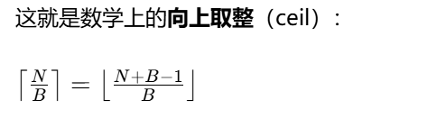

## **init**.py给父目录文件夹标记成Py包

- **all** 定义 * 导入， 会导入哪些名字

## @dataclass(frozen=True)

- frozen=True不可变对象

## append vs extend

- `append(xxx)`：**把传入的整个东西当成【一个元素】追加到列表末尾**
- `extend(xxx)`：**把传入的可迭代对象里面的每一个元素，逐个拿出来追加进列表**

## cupy.RawKernel(ptx_code, kernel_name) [docs](https://docs.cupy.dev/en/stable/user_guide/kernel.html#raw-kernels)

```
# 签名
cp.RawKernel(source: str, name: str, options=(), backend='nvrtc')
- `source`：CUDA C 代码字符串，**函数必须 `extern "C"`**，否则名字被 C++ 修饰，找不到 kernel（新手高频坑！）
- `name`：和代码里的函数名字严格一致，这里就是 `"hello_gpu"`
- `options`：nvrtc 编译参数，后面 sm_86、加 - O3 优化才会用到，Task2 暂时不用
```

### kernel调用语法

```
kernel(grid, block, args, stream=None)


- `grid = (grid_x, grid_y, grid_z)`
- `block = (block_x, block_y, block_z)`
- `args`：tuple，里面放 cupy 数组 / 标量，对应 kernel 的形参；无参就写`()`
- `stream`：后面阶段 5 才学，默认 None，用默认流
```

### Cuda执行层次

> CUDA 的执行层级从大到小：**Grid → Block → Thread**
> 硬件最小调度单位：**Warp（32 个 thread 一组，硬件自动分组，你暂时不用写它）**

```
先拿一个工厂流水线类比：

- **Grid = 整个大工厂（一次 Kernel 启动的全部任务）**
- **Block = 工厂里面一个独立车间**
- **Thread = 车间里一个工人**
```

## cuda函数修饰符 3个

> threadIdx 当前线程再自己这个Block车间内部的编号 x y z
> threadIdx.x 范围 0~255
> blockIdx 当前Block（车间）在 Grid（整个工厂）里面的编号

```
- `__global__`：**主机 (CPU) 调用，在 GPU 上跑的函数，也就是 Kernel**
  - 调用方式特殊：`<<<grid, block>>>`（CuPy 里封装成 `kernel(grid, block, args)`）
  - 返回值必须是 `void`，不能 return
- 另外两个后面才遇到：
  - `__device__`：GPU 内部调用、GPU 上执行，CPU 不能直接调用
  - `__host__`：CPU 上跑，就是普通 C 函数
```

### grid block

```py
grid = (grid_x, grid_y, grid_z)
block = (block_x, block_y, block_z)
`block=(256,1,1)`：**一个 Block 里面，x 方向 256 个线程，y,z 方向各 1**，也就是这个车间 256 个工人。
`grid=(1,1,1)`：整个 Grid 里面，x 方向 1 个 Block，y,z 方向各 1 → 整个工厂就 1 个车间。
```

## total thread count

> total_threads = grid_x × grid_y × grid_z × block_x × block_y × block_z

```py
grid=(4,1,1)
block=(128,1,1)
# 总线程：4 * 128 = 512线程，4个车间，每个车间128工人
```

#### 为什么cp.cuda.get_current_stream().synchronize()` 同步？

### 核心：CPU 和 GPU 是**异步执行**！

CPU 发启动 Kernel 命令给 GPU 之后：
✅ CPU 不会停下等 GPU 跑完！CPU 发完指令，直接继续跑后面 Python 代码
✅ GPU 拿到任务，自己在后台并行跑线程
GPU 的 `printf` 有一个缓冲区，**缓冲区不会自动刷新到控制台**，必须满足两点之一才能打印出来：

1. 流同步 / 设备同步：CPU 卡住，等待 GPU 当前流里所有任务全部执行完毕，GPU 才把 printf 缓冲区输出
2. 缓冲区写满

如果不写 `.synchronize()`：
CPU 刚把 kernel 启动命令发给 GPU，CPU 代码立刻结束、程序退出，GPU 还没来得及跑、还没把打印缓冲区刷出来 → **控制台空空如也，啥都看不到**

## 同步

> 同步的代价：CPU 被阻塞，等待 GPU，损失异步并行能力。
> 后面正式写算子、算性能的时候，**正常业务 kernel 我们尽量少同步**；只有调试 printf、验证结果的时候才同步。

- `cp.cuda.get_current_stream().synchronize()`：**只等当前这个默认流里面的任务**（推荐，粒度小）
- `cp.cuda.Device().synchronize()`：等待这个 GPU 上**所有流、所有任务**，范围更大，会等无关任务

### 400万字节B == 3.81MB 4B

### CUDA C

> **在标准 C 语言基础上，NVIDIA 扩展出来、用来写 GPU 内核的语言**。
> 本质就是 C，只是多了一堆 CUDA 专属关键字、内置变量，让你可以写跑在 GPU 上的并行程序

- **global** kernel函数，cpu调用， GPU执行
- **device** GPU内部函数，GPU上调用， GPU上跑
- **host** CPU上跑， 等价普通C函数

### Cuda内置只读变量

- `threadIdx.x`：线程在 block 内部编号
- `blockIdx.x`：block 在 grid 里的编号
- `blockDim.x`：一个 block 有多少线程
- `gridDim.x`：整个 grid 一共有多少 block

```
i = blockIdx.x * blockDim.x + threadIdx.x
    └─第几个车间─┘   └车间人数┘   └车间内工号┘
Block 0                Block 1                Block 2
[0 .. 255]            [256 .. 511]           [512 .. 767]
 ↑                       ↑                      ↑
 tid=0..255              tid=0..255             tid=0..255
 blockIdx=0              blockIdx=1             blockIdx=2

`threadIdx.x` **只在 Block 内部唯一**，不同 Block 里会重复出现 0~255。
```

### CUDA C编译方式

- 离线编译
- > 把 CUDA C 代码存成 `xxx.cu` 文件，用 NVIDIA 的 `nvcc` 编译器编译。
  > `nvcc` 会自动把 CUDA C 拆开：主机代码交给 C++ 编译器，kernel 设备代码编译成 GPU 指令（PTX/cubin）。
- 在线即时编译（NVRTC
- > 把 CUDA C 放到字符串里，程序运行的时候再交给 NVRTC 编译器在内存里实时编译，**不用单独存.cu 文件**，适合快速试错，就是你现在的玩法。
- `if (i < n)` 必须写,**越界写是 GPU 编程最难查的 bug 之一**。所以边界判断是每个 elementwise kernel 的标配。

### 数学内向上取整

> **"宁可多开线程，用 if 挡住；也绝不能少开线程漏掉数据"**。
> 多开浪费的成本，只是少量线程空转，几乎为零；少开的成本，是结果错误。
> 

```
(N + BLOCK - 1) // BLOCK
```

## GPU硬件模型

> CUDA 依赖于底层硬件的概念模型。在CUDA编程中，GPU可以被视为一组流式多处理器（SM），这些SM被组织成称为图形处理集群（GPC）的组。每个 SM 包含一个本地寄存器文件、统一的数据缓存以及多个执行计算的功能单元

## SM 每个SM是128个cuda核心 20 * 128 = 3840个cuda核心

M = Streaming Multiprocessor，流式多处理器，GPU 真正并行计算单元：

- GPU = 一堆 SM 拼起来
- 任务调度器把 Block 分配到空闲 SM 上
- 一个 SM 内部，再分成 32 线程一组 = warp（硬件最小调度单位）
- 同一个 Block 里面的线程只能放在同一个 SM 里，Block 不能跨 SM 拆分！
  👉 这就是最核心限制：**Block 不能跨 SM，Block 之间不能直接同步通信，只有同一个 Block 内部线程可以用 shared memory + \__syncthreads ()**

### GPU包含多个流式多处理器（SM），每个SM包含许多功能单元。图形处理集群（GPC）是SM的集合。GPU是一组连接到GPU内存的GPC。

> CPU通常有多个核心和一个连接系统内存的内存控制器。CPU和GPU通过PCIe或NVLINK等互连连接连接

### 怎么算grid大小

```
硬件限制：sm_86 单 Block 最多 **1024 线程**，每 SM 最多 **2048 线程**。
由block反推grid
grid_x = (N + block_x - 1) // block_x
```

### RTX 3060 有30个SM

你的 3060 Laptop 是 GA106，**30 个 SM**（3840 CUDA Core = 30×128）。
如果只用 1 个 block，**只有一个 SM 在干活，其余 29 个全部空闲**，性能直接砍到 1/30。
Block 数量多了以后，GPU 硬件调度器会把它们分配到不同 SM 上并行跑：

```
1,000,000 元素 / 256 = 3907 blocks
30 SM × 每 SM 最多 8 个 256线程 block = 240 blocks 同时驻留
3907 / 240 ≈ 16 波（wave）
```

这才是 GPU 的正确打开方式：**用海量 Block 填满所有 SM**。

### grid-stride loop

> 线程总数可以小于 N，一个线程循环负责多个元素
> one thread per element N变大 block数线性增长

```c
extern "C" __global__ void index_kernel_stride(int* out, int n) {
// grid=(240,1,1), block=(256,1,1)
// tot thread = 240 * 256 = 61440
//把整个长数组，切成很多片，每一片长度 = stride；
//每一片里面第 0 个交给线程 0，第 1 个交给线程 1，第 2 个交给线程 2……
// stride个片就行
    int stride = gridDim.x * blockDim.x;          // 全局总线程数
    for (int i = blockIdx.x * blockDim.x + threadIdx.x; i < n; i += stride) {
        out[i] = i;
    }
}

```

## Host <-> Device内存拷贝

- Host CPU + 内存（普通内存条，numpy 数组放这里）
- Device - GPU + 显存（cupy 数组放在这里）

```txt
原生 CUDA：
- `cudaMalloc`：在显存上分配空间（Cupy `cp.empty()` / `cp.array()` 底层封装了它）
- `cudaMemcpy`：内存搬运，分 4 种方向：
  1. `cudaMemcpyHostToDevice`：CPU 内存 → GPU 显存
  2. `cudaMemcpyDeviceToHost`：GPU 显存 → CPU 内存
  3. `cudaMemcpyDeviceToDevice`：显存内部拷贝
  4. `cudaMemcpyHostToHost`：内存内部拷贝（很少用）
```

Cupy 封装简化：

- `cp.array(numpy_arr)` → HostToDevice
- `gpu_arr.get()` → DeviceToHost

## 数据位置区分

- h_ 前缀。 host CPU内存， numpy GPU不能直接访问
- d_ 前缀， Device 显存， cupy数组

### cp函数

`cp.empty(N, dtype=cp.int32)`：**在 GPU 显存里划出一块内存空间，用来存放数据，等价原生 CUDA 的 `cudaMalloc`**
`dtype=cp.int32`：每个元素是 int32，占 4 字节

## GPU计时

> GPU 的任务是**异步排队执行**的；`Event` 就是在队列上打标记；`synchronize()` 就是等队列里所有活全部干完，我们才能读时间。

```
GPU 有一个任务队列，叫 **stream（流）**。
所有操作：H2D 拷贝、跑 kernel、D2H 拷贝，**都会按顺序放进这个流里面排队**，GPU 按顺序一个一个执行。
```

### 元素级算子

- 是深度学习里最常见的：add、sub、mul、relu、sigmoid、tanh、clip

> 每个线程只处理 1 个元素，线程之间**不需要互相通信、不需要同步**
> vector add 第i个元素， 只需要a[i], b[i], 别的线程数据完全不用碰

### 显存合并访问

> 决定你写的 kernel 能不能跑满显存带宽
> 好情况：线程 0 读 a [0]，线程 1 读 a [1]，线程 2 读 a [2]…… 地址连续 → GPU 一次大请求读完，**合并访存，带宽拉满**

### 核函数参数传递: 标量a怎么传给device

**global** void axpy_kernel(float a, float *x, float *y, int n)
