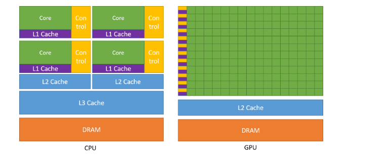
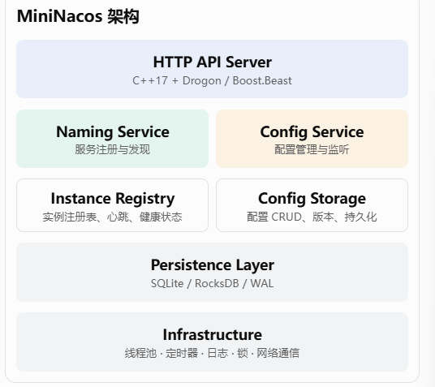
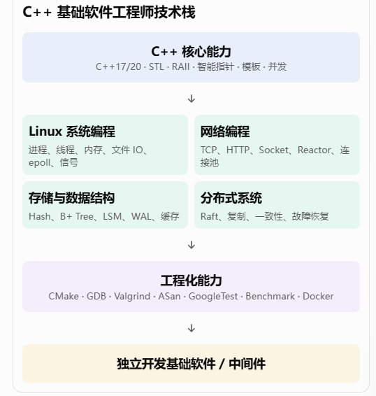

### GPU vs CPU

GPU和CPU的设计目标不同。CPU设计上擅长以最快速度执行串行操作序列（称为线程），并可并行执行数十个线程;而GPU则设计为并行执行数千线程，在单线程性能下降时牺牲以实现更高的总吞吐量。

GPU专注于高度并行计算，并分配更多晶体管用于数据处理单元，而CPU则投入更多晶体管用于数据缓存和流量控制。



> GPU包含多个流式多处理器（SM），每个SM包含许多功能单元。图形处理集群（GPC）是SM的集合。GPU是一组连接到GPU内存的GPC。CPU通常有多个核心和一个连接系统内存的内存控制器。CPU和GPU通过PCIe或NVLINK等互连连接连接。

## 冷更新 vs 热更新

> 冷更新：下载完整新二进制 → 必须重启进程才能跑新版代码
> 热更新 = 进程不退出、不重启，在运行的时候，把一部分代码 / 资源替换成新版本，马上生效

## AB版本更新 （灰度发布 / A/B 发布）

AB 发布：线上同时跑**两个版本**：

- A：老版本（stable）
- B：新版本（待验证）
  流量按规则切分：一部分用户走 A，一部分走 B。
  观察指标：报错、延迟、崩溃率。
- B 没问题 → 全量切到 B，下线 A
- B 出问题 → 立刻切回 A，回滚

### OpenGL 图形渲染

### PyTorch

```
1. 实现一个简化版的 AI 推理服务。

项目：MiniInference

核心功能：

- 使用 LibTorch 加载模型。
- 支持图片、文本等输入。
- Tensor 内存管理。
- Batch 推理。
- 多线程并发推理。
- 模型热加载。
- GPU / CPU 推理切换。
- 推理耗时统计。

2. 项目：MiniTensor

自己实现一个简化版 Tensor 计算库。

核心功能：
- Tensor 数据结构。
- Shape / Stride 管理。
- 矩阵乘法。
- Broadcasting。
- ReLU / Sigmoid。
- 自动求导。
- CPU 算子。
- CUDA 算子。
```

### 算子

**算子（Operator / Op）就是深度学习里的一个计算函数 / 计算单元**。

> 输入一个或多个 Tensor，输出一个或多个 Tensor，附带前向计算逻辑 + 反向梯度逻辑（需要自动微分的话）。
> **算子首先是一个抽象概念：代表一套计算规则（forward + backward）**

1. **算子（Op，抽象层）**：定义「要做什么计算」
2. **算子实现（Kernel，内核）**：定义「在某个硬件上怎么算」

```txt
举例子：`add` 算子

- 抽象：`out = a + b`，梯度规则 `d_a = d_out, d_b = d_out`
- CPU Kernel：C++ + OpenMP + SIMD 实现，跑在 CPU
- CUDA Kernel：CUDA C++ 写的 GPU 核函数，跑在 GPU
- NPU Kernel：给昇腾 / 瑞芯微 NPU 的实现

**对外都叫 add 算子，但是底层代码完全不一样，不能互换运行。**
```

#### 算子内部一般分成两块：

1. **前向（forward）**：输入 tensor → 算出输出 tensor
2. **反向（backward）**：传入输出的梯度，算出输入的梯度（自动微分用）

### 多线程算子 = 把一个算子的计算任务，拆成多个独立子块，交给多个线程并行执行的算子实现

| 技术         | 核心定位       | 主要用途                 |
| ------------ | -------------- | ------------------------ |
| PyTorch      | 深度学习框架   | 建模、训练、推理         |
| TensorFlow   | 深度学习框架   | 建模、训练、推理、部署   |
| ONNX         | 模型交换标准   | 模型格式、跨框架互操作   |
| ONNX Runtime | 推理运行时     | 加载 ONNX 模型并执行推理 |
| TensorRT     | 高性能推理 SDK | NVIDIA GPU 推理优化      |

#### Pytorch 训练模型

- Tensor 运算
- 自动求导（Autograd）
- 神经网络构建
- 模型训练
- 模型推理

#### TensorFlow

> PyTorch 动态图 Py生态成熟
> TensorFlow 有TensorFlow Lite, TensorFlow Serving部署生态

#### ONNX 定义模型结构 算子如何表示 Tensor数据如何组织 模型IO如何描述

#### ONNX Runtime

> 它的工作是：

- 1. 加载 ONNX 模型。
- 2. 解析模型计算图。
- 3. 优化计算图。
- 4. 调度算子执行。
- 5. 使用 CPU、CUDA 等执行后端。
- 6. 返回推理结果。

```txt
Pytorch导出model.onnx
model.onnx
    |
    v
ONNX Runtime
    |
    v
CPU / GPU
    |
    v
推理结果
-----------------------------------
pytorch    tensorflow
        |
导出    |
        ONNX

模型部署推理
ONNX Runtime    TensorRT

CPU/GPU执行
```

## 存储

> KV存储， 对象存储， MinIO
> 分布式文件系统 CephFS
> 消息队列、日志存储 Kafka, JetStream
> 文件系统 ext4.
> 块存储Ceph RBD
> 分布式缓存 redis

```txt
1. MiniS3 对象存储
技术栈：Go + HTTP + Linux + SQLite/PostgreSQL + Docker。

建议实现：
1. 文件上传、下载、删除。
2. Bucket 和 Object 管理。
3. Multipart Upload，大文件分片上传。
4. 文件元数据管理。
5. 文件 MD5 / SHA256 校验。
6. 多磁盘存储与磁盘故障检测。
7. 数据副本与故障恢复。
8. S3 兼容 API。
后续进阶：
- Erasure Coding（纠删码）。
- 一致性哈希。
- 多节点数据分布。
- 元数据缓存。
2. MiniMQ 持久化消息队列
技术栈：Go + Linux + TCP + mmap + 文件 I/O。

建议实现：
1. Producer / Consumer。
2. Topic / Partition。
3. Commit Log 持久化。
4. 日志分段和索引。
5. 消息消费位点。
6. 批量写入。
7. 刷盘策略。
8. 崩溃恢复。
9. 消息过期与日志清理。
后续进阶：
- 多副本复制。
- Leader / Follower。
- Raft 一致性协议。
- 消费者组。
- 零拷贝。
3. MiniFS 简化版文件系统
技术栈：C + Linux + FUSE。

建议实现：
1. 文件创建、删除。
2. 目录管理。
3. inode 管理。
4. 数据块分配。
5. 文件读写。
6. 元数据持久化。
7. 崩溃恢复。
```

### S3

> S3 是统一的访问接口，底层存储可以有完全不同的实现。实现 S3 协议，不等于自动兼容所有存储来源。S3 解决的是客户端如何访问对象，底层数据究竟放在哪里，需要你自己设计存储适配层。
> 客户端不需要关心底层数据存在哪里。统一使用S3 API.

```txt
S3 API Layer

Object Service Layer

Storage Abstraction Layer
```

## MiniNacos



```
服务注册与发现（Naming）
API	方法	功能
/naming/instance	POST	注册实例
/naming/instance	DELETE	注销实例
/naming/instance/heartbeat	PUT	实例心跳
/naming/instances	GET	查询服务实例
/naming/services	GET	查询服务列表
/naming/health	GET	查询实例健康状态
POST /naming/instance

{
  "serviceName": "user-service",
  "ip": "127.0.0.1",
  "port": 8080,
  "clusterName": "DEFAULT",
  "weight": 1.0,
  "ephemeral": true
}
struct Instance {
    std::string service_name;
    std::string ip;
    uint16_t port;
    double weight;

    bool healthy;
    bool ephemeral;

    uint64_t last_heartbeat;
};
配置管理（Config）
API	方法	功能
/config	POST	发布配置
/config	GET	获取配置
/config	PUT	更新配置
/config	DELETE	删除配置
/config/listener	POST	监听配置变化
/config/history	GET	查询配置历史
{
  "namespace": "dev",
  "group": "DEFAULT_GROUP",
  "dataId": "application.yaml",
  "content": "server.port: 8080"
}
```

### 中间件开发

> 分布式缓存 MQ API网关 反向代理
> 分布式KV存储 服务治理中间件
> 数据库 执行引擎， 存储引擎， 查询优化器
> 

```txt
MiniFlink 数据源 → 算子处理 → 数据流转 → 窗口计算 → 结果输出
模块	实现内容	难度
Stream API	Source、Map、Filter、Sink	低
算子系统	算子抽象、算子组合	中
Pipeline	算子连接与执行	中
并发执行	ThreadPool、任务队列	中
Window	Tumbling Window、Sliding Window	中
状态管理	Keyed State	中高
Checkpoint	状态快照与恢复	高
网络传输	TCP 数据传输	中高
功能：
    实时读取日志文件。
    对数据进行过滤、转换。
    按用户 ID 分组。
    实现 5 秒滚动窗口统计。
    多线程并发处理。
    统计吞吐量、延迟。
    模拟进程异常，进行状态恢复。
DAG调度(MiniRay)
其中：
- Task A：CPU 计算
- Task B：CPU 计算
- Task C：CUDA GPU 计算
- Task D：CPU 计算
- Task E：GPU 计算
调度器需要解决：
1. 哪些任务可以执行？
2. 哪些任务依赖尚未完成？
3. 当前 CPU 是否有空闲资源？
4. 当前 GPU 是否有空闲资源？
5. 如何分配任务？
6. 任务执行失败怎么办？
核心功能
模块	实现内容	难度
DAG 构建	任务节点、依赖关系	中
DAG 校验	环检测、拓扑排序	中
Scheduler	就绪任务调度	中
CPU Worker	多线程执行任务	中
GPU Worker	CUDA Kernel 执行	高
Resource Manager	CPU/GPU 资源管理	高
Task State	Pending、Running、Finished、Failed	中
Data Transfer	CPU/GPU 数据传输	高
Fault Recovery	任务失败重试	高
```
